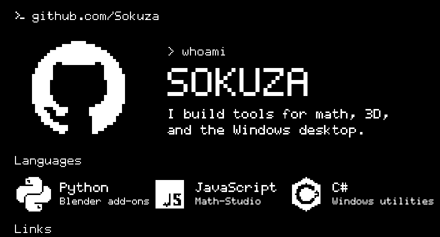

 
 
 
 

Selected projects

- [geometry_nodes_exporter](https://github.com/Sokuza/geometry_nodes_exporter)
- [Math-Studio](https://github.com/Sokuza/Math-Studio)
- [blender-mathfunction](https://github.com/Sokuza/blender-mathfunction)
- [BulkRename](https://github.com/Sokuza/BulkRename)
- [GeoStringAnim](https://github.com/Sokuza/GeoStringAnim)
- [ImageInsert](https://github.com/Sokuza/ImageInsert)
- [All repositories](https://github.com/Sokuza?tab=repositories)

